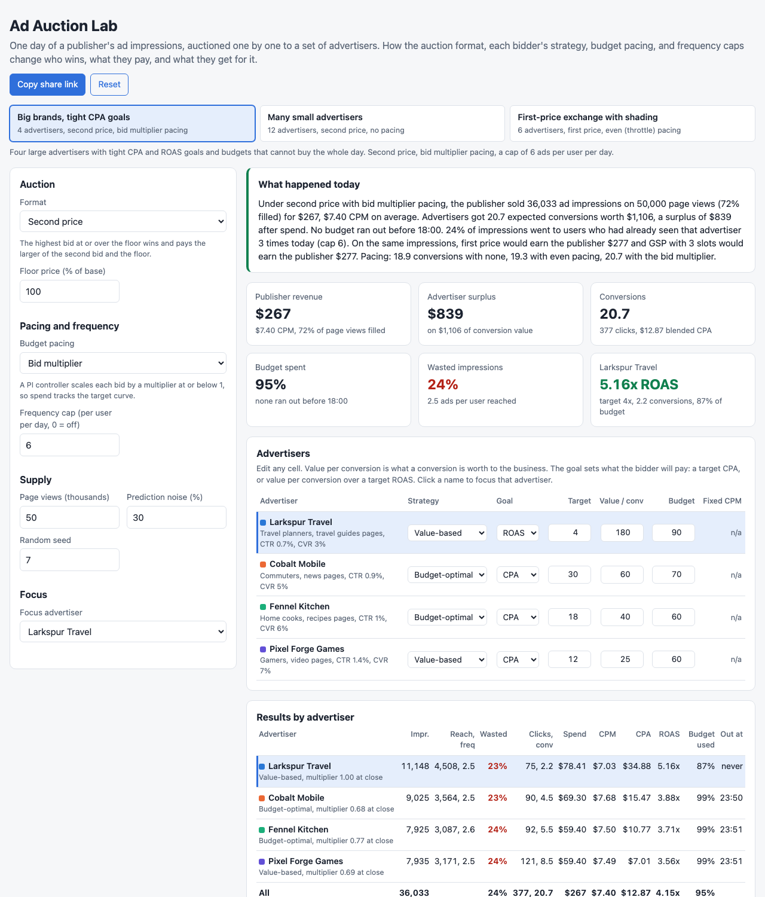

# Ad Auction Lab

A browser simulator of programmatic advertising auctions over one day. It generates a publisher's page views over 24 hours, each with a user, the user's segment, a page context, and a floor price, and auctions every one of them to a set of made-up advertisers. Each advertiser has a daily budget, a CPA or ROAS goal, a value per conversion, and a bidding strategy: a fixed CPM, value-based bidding, bid shading for first-price auctions, or a budget-constrained optimal bidder whose bid multiplier is set by a pacing controller. The same day can be run under second price with a reserve, first price, or generalized second price over three ad slots, with no pacing, even pacing, or bid multiplier pacing, and with or without a per-user frequency cap. It reports what each advertiser bought and paid, what the publisher earned, and an inspector for any single auction.



## Why

Most of the money in display and app advertising moves through auctions that run in about 100 milliseconds, millions of times a day, and the rules of those auctions decide a lot that marketers and product managers care about: why a campaign spent its whole budget by 9 a.m., why CPA is fine but conversions are low, why the same user saw one ad 40 times, whether a move from second to first price helps the publisher, and why bidders started shading. Each of these is a small model. This puts them on one seeded day so the effects show up as numbers on the same impressions.

Results for the three presets (seed 7, 50,000 page views, default settings):

| Scenario | Run | Publisher revenue | Advertiser surplus | Expected conversions | Budgets out before 18:00 |
|---|---|---|---|---|---|
| Big brands, tight CPA goals (4 advertisers) | Second price, bid multiplier pacing | $267 | $839 | 20.7 | 0 of 4 |
| | same, first price | $277 | $812 | 20.4 | 0 of 4 |
| | same, GSP with 3 slots | $277 | $1,137 | 26.0 | 0 of 4 |
| | same, no pacing | $277 | | 18.9 | 1 of 4 (13:00) |
| Many small advertisers (12) | Second price, no pacing | $216 | $177 | 12.2 | 10 of 12 (first at 07:34) |
| | same, even pacing | $216 | | 15.0 | 0 of 12 |
| | same, bid multiplier pacing | $214 | | 18.2 | 0 of 12 |
| | same, first price, no pacing | $216 | $90 | 9.2 | |
| First-price exchange with shading (6) | First price, even pacing | $372 | $621 | 17.5 | 0 of 6 |
| | same, second price | $375 | $657 | 18.9 | 0 of 6 |
| | same, no pacing | $378 | | 15.6 | 4 of 6 |
| | same, bid multiplier pacing | $377 | | 20.8 | 0 of 6 |

Advertiser surplus is the value of conversions minus spend. Conversions are expected counts (see below). The day is small on purpose, so budgets are tens of dollars; the ratios are the point.

What the presets show:

- **Without pacing, small budgets are gone by breakfast.** Twelve small advertisers with no pacing: 10 of 12 run out before 18:00, the first at 07:34, and none of them sees the evening peak, when 43% of the day's traffic arrives. Even pacing on the same budgets buys 15.0 conversions instead of 12.2 (+23%), and the bid multiplier 18.2 (+49%), because it lowers bids as well as spreading them, so the same dollars buy more impressions at lower prices. Publisher revenue barely moves: the budgets get spent either way.
- **When budgets bind, the auction format moves surplus, not revenue.** For the big brands, first price earns the publisher $277 against $267 in second price, 4% more, and GSP $277. Most of the money is the budgets. What changes is who wins which impression and what it is worth: GSP sells three slots per page and raises conversions to 26.0 by giving lower-value advertisers the lower slots.
- **First price punishes naive bidders.** With twelve small advertisers bidding full value in first price, they pay $8.75 CPM against $6.41, and advertiser surplus halves ($90 against $177) for the same publisher revenue. That is why bid shading exists.
- **Shading learns its way back toward second price.** On the first-price exchange, the three shading bidders learn factors of 0.41, 0.54, and 0.62 of value from "minimum bid to win" feedback, and pay $7.47 to $10.99 CPM while the two full-value bidders pay $10.35 and $14.95. First price with shading earns the publisher $372 against $375 under second price, close to revenue equivalence.
- **Truthful bidding is a best response in second price, and only there.** The focus advertiser, with no budget limit, bids 30% to 160% of its value against everyone else's recorded bids. In second price its surplus peaks at exactly 100% (Larkspur Travel in the big brands preset: $1,399 at 100%, $1,393 at 85%, $1,396 at 115%). In first price bidding value earns $0 and 30% of value earns the most of the bids tried ($910).
- **A frequency cap trades frequency for reach.** For the big brands with no cap, 51.5% of impressions go to users who have already seen that advertiser three times today, since a few heavy users see hundreds of pages. A cap of 3 brings that to 0, raises unique reach from 12,982 to 16,371, and conversions from 19.3 to 20.9, while the publisher earns $252 instead of $277. The preset's cap of 6 sits in between.

The presets were set up once so that budgets bind and pacing has something to do. Budgets were cut for the big brands after a first run where nobody ran out; nothing else was tuned to favor a format or a pacing mode.

## How it works

```
 seed ──> users: segment, visit weight (power law, a few heavy users)
     └──> 50,000 page views over 24 h (quiet at 04:00, morning and lunch bumps, evening peak)
          each: user, segment, page context, quality factor, floor price
     └──> each bidder's prediction error per page view (lognormal, mean 1)
                                   |
   for every page view, in time order:
     each advertiser: budget left?  under the frequency cap?  throttled?
        predicted conversion rate = CTR x segment fit x context fit x quality x error x CVR
        bid = strategy(goal value x predicted conversion rate) x pacing multiplier, capped by budget left
     auction: second price / first price / GSP over 3 slots, floor as reserve
     winner(s) pay, exposures and fatigue update, shading bidders get min-bid-to-win feedback
   every 15 minutes: pacing controllers compare spend to the target curve
                                   |
   metrics per advertiser, publisher revenue, welfare; then the same day under every format,
   every pacing mode, and the truthfulness test
```

- **Supply.** Page views follow a daily traffic shape: 13% of the day's traffic arrives before 07:00, 43% after 18:00. Users come from a pool of one per five page views with visit weights falling off as rank^-0.8, so the top 5% of users see more than a quarter of the pages. Each user is in one of five segments (commuters, parents, gamers, travel planners, home cooks); 45% of their page views are on their segment's home context and the rest are spread over news, sports, recipes, video, and travel guides. Each page view has a lognormal quality factor and a floor of $0.80 to $2.50 CPM by context, varied 20% either way and scaled by the floor setting.
- **Predictions.** An advertiser's click-through rate is its base rate, times 1.8 if the user is in its target segment (0.85 if not), times 1.3 on its best context, times the page's quality. Its prediction carries a lognormal error with a 30% sigma by default, drawn once per page view and advertiser so every run sees the same errors.
- **Outcomes.** Clicks and conversions are expected counts: each won impression adds its true click probability and its true conversion probability. True click-through falls 30% with each earlier exposure of the same advertiser to the same user that day (ad fatigue). Exposures after the third are counted as wasted. Conversion value is value per conversion times expected conversions; welfare is the total; surplus is welfare minus spend.
- **Strategies.** The goal value is the target CPA, or value per conversion over the target ROAS. Fixed bid: one CPM everywhere. Value-based: goal value times predicted conversion rate. Bid shading: in first price, value times a shading factor s that maximizes (1 - s) x P(minimum bid to win <= s x value) over the last 400 feedback ratios, refit every 50 auctions; in second price it bids value. Budget-optimal: value times a multiplier at or below 1 from its own pacing controller, whatever the global pacing setting.
- **Auctions.** Bids under the floor are dropped. Second price: the highest bid wins and pays the larger of the second bid and the floor. First price: the winner pays its bid. GSP: bidders are ranked by bid; slot k (k = 1, 2, 3, with 100%, 60%, and 35% of the clicks) pays its click share times the next bid down, or times the floor. Ties go to the advertiser listed first.
- **Pacing.** The target curve is the expected share of the day's traffic so far. Every 15 minutes a velocity-form PI controller takes the error, target share minus spent share of budget, and updates either the share of auctions entered (even pacing, a deterministic hash decides each entry) or the log of the bid multiplier (bid multiplier pacing). Clamping the output is the anti-windup. An advertiser is out when less than 1% of its budget is left.
- **Truthfulness test.** The focus advertiser runs with no budget limit and values each impression at its value per conversion times its predicted conversion rate. The day is run once in second price and once in first price with it bidding value, and every other bid is recorded. It then bids 30% to 160% of value against those fixed bids, and its surplus is measured against its own predicted value. Holding the others fixed is the textbook best-response question; letting them react through their pacing would mix in a second effect.

The engine is `src/auction.js` with no DOM code. A day of 50,000 page views with 12 advertisers takes about 0.2 s with every bid recorded for the inspector. The page runs the selected day, then the format, pacing, and truthfulness comparisons (eight more runs) in a Web Worker (`src/worker.js`).

## What you see

- **Presets**: big brands with tight CPA and ROAS goals, many small advertisers, and a first-price exchange with bid shading.
- **Summary** in a few sentences and tiles for publisher revenue, advertiser surplus, conversions, budget spent, wasted impressions, and the focus advertiser against its goal.
- **Advertiser setup table**: strategy, goal, target, value per conversion, budget, and fixed CPM, all editable.
- **Results by advertiser**: impressions, reach and frequency, wasted impressions, clicks and conversions, spend, CPM, CPA, ROAS, budget used, and when the budget ran out. Misses against the goal are red.
- **Spend over the day**: cumulative spend as a share of budget, one line per advertiser on one y-axis, against the target curve. Hover for every advertiser's share and controller value at that time.
- **Win rate** per advertiser with average bid and price paid, and a **clearing price histogram** stacked by winner.
- **Auction format comparison**: publisher revenue, advertiser surplus, welfare, conversions, ad impressions, CPM, and fill under each format on the same impressions, and the **truthfulness table**.
- **Pacing comparison**: conversions, welfare, spend, CPA, and budget exhaustion under each pacing mode.
- **Auction inspector**: any single auction, with the page view, the floor, each advertiser's value, pacing state, bid, result, and price, and a sentence on why the winner paid what it paid. Buttons jump to the next close race or the next win for the focus advertiser.

Everything is in the URL hash (only values that differ from the preset), so a scenario can be shared as a link. Light and dark mode follow the system. Column headers and tiles have tooltips.

## Run it

It is a static site with no build step and no dependencies. ES modules need a web server, so `file://` will not work. From this folder run:

```bash
python3 -m http.server 8000
```

Then open http://localhost:8000. Add `?noworker` to the URL to run everything on the main thread (used for headless screenshots).

## Tests

```bash
npm test        # or: node --test
```

45 tests cover the engine:

- RNG and hash determinism, the traffic shape and target curve, the world reproducible from the seed and following the traffic shape, heavy users, and floors scaling with the reserve.
- Second price pays the second highest bid or the reserve (hand cases and 500 random auctions), first price pays its own bid, ties, and GSP slot assignment and prices on a hand-worked example (bids $10, $8, $5, $2, reserve $1: slots pay $8, $3, $0.70) and with fewer bidders than slots.
- Truthful bidding as a best response in second price on a constructed case, checked against 31 bid levels; bidding value earns nothing in first price; the same two facts over a simulated day; reading the competition from a traced run.
- The optimal shade on uniform ratios (0.75, matching the closed form), shading lowering CPM in first price on the same impressions, and shading having no effect in second price.
- The PI step's direction and limits, the controller tracking a target on a synthetic plant, throttle and multiplier pacing keeping spend within 5 points of the target curve at six times of day, budgets running out early without pacing and lasting with it, pacing buying more conversions, spend never exceeding budget, and the budget-optimal bidder always pacing itself.
- Frequency caps enforced per user and advertiser (also across GSP slots), a tighter cap cutting wasted impressions and raising reach, and ad fatigue on a hand-built case.
- Accounting: spend equals the sum of prices paid in every format, revenue equals total spend, impressions, wins, and the price histogram all count the same ad impressions, CPA, ROAS, CPM, budget use, welfare, and surplus, spend over time ending at total spend, and the trace's status counts matching the totals.
- Format comparison on the same impressions, first price taking surplus from naive bidders, determinism of all runs, seed sensitivity, every preset in every format, and config clamping and URL round trip.

## CI and deploy

`.github/workflows/ci.yml` runs `npm test` on Node 22 for every push and pull request. On push to `main` a second job publishes the site to GitHub Pages with `actions/upload-pages-artifact@v3` and `actions/deploy-pages@v4`. Set Pages to "GitHub Actions" as the source in the repo settings. The workflow has not been run locally.

## Production notes

- A real exchange runs these auctions in a bidder service with a latency budget of about 100 ms per request, across many supply partners, and the bidder sees only a bid request, not the other bids. The simulator's global view is what makes the format and truthfulness comparisons possible; a production system would learn the competition from win and loss logs.
- Predictions come from trained click and conversion models with calibration monitoring, and conversions arrive hours or days after the click, so pacing and shading work on delayed, noisy feedback. Here outcomes are expected values and known at once.
- Pacing runs per campaign across many servers with shared spend counters, so overspend from in-flight bids and counter lag matters. Budget smoothing usually also forecasts the rest of the day's supply instead of following a fixed traffic curve.
- Shading in production is a model per bidder, segment, and supply source, trained on bid landscape data, often with exploration so the bidder keeps learning where it does not win.
- Frequency caps need a user identity across devices and sessions, which is getting weaker as third-party identifiers go away; reach and frequency numbers would come with uncertainty.
- Floors would be set per placement from bid history (dynamic floors), which changes the revenue comparison between formats.

## License

MIT. See [LICENSE](LICENSE).
